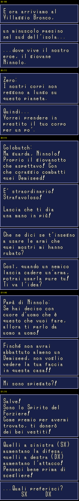

# Gunple: Gunman's Proof — in italiano

Un ragazzino del Far West, un'isola invasa da mostri caduti dallo spazio, due sceriffi alieni che gli prendono "in prestito" il corpo. Gunple è uscito solo in Giappone nel 1997, su un Super Famicom ormai a fine carriera, e quasi nessuno se lo ricorda. Peccato, perché è uno degli action-RPG più simpatici della console: chi ha giocato a Zelda: A Link to the Past si sente a casa, però qui si spara, si fanno a pugni i boss e si incontrano fantasmi che cantano.

Da oggi lo potete giocare anche in italiano.



## Per giocarci

Prendete `gunple_ita.bps` dalla [pagina delle release](https://github.com/SancioPanza88/gunple-ita/releases) e applicatelo alla ROM giapponese **pulita**, cioè senza nessun'altra patch sopra:

| | |
|---|---|
| File | `Ganpuru - Gunman's Proof (Japan).sfc` |
| Dimensione | 3.145.728 byte (senza header) |
| CRC32 | `AF415C24` |
| SHA-1 | `dad73d2c0b1a3c916d40c4a208566ee4193333b2` |

La patch si applica con [Rom Patcher JS](https://www.marcrobledo.com/RomPatcher.js/), direttamente dal browser, oppure con [Floating IPS](https://www.romhacking.net/utilities/1040/). Se la vostra ROM è un .smc da 3.146.240 byte ha l'header: Rom Patcher lo toglie da solo, con Floating IPS dovete toglierlo voi.

La ROM non la trovate qui e non posso darvela.

## Cosa c'è dentro

Tutto il testo del gioco, dall'introduzione ai titoli di coda: 513 messaggi, compresi negozi, boss e quel fantasma che non la smette di cantare. In più ho tradotto le schede delle mosse, i menu, le scritte PUNTI e VITA in alto sullo schermo, il menu del titolo, la schermata dei salvataggi e le opzioni del game over, e ho aggiunto le lettere accentate al font.

Ho lasciato com'erano il logo del titolo, la scritta GAME OVER e il pulsante "HELLO!" della schermata del nome, di cui onestamente non ho ancora capito lo scopo. Per le maiuscole accentate nel font non c'era spazio, quindi troverete E' al posto di È, come nelle traduzioni amatoriali di una volta.

## Una cosa da sapere

Non ho fatto tutto da solo. Per questo progetto mi sono fatto aiutare da un'intelligenza artificiale (Claude, di Anthropic): con lei ho capito come il gioco memorizza il testo, ho scritto gli strumenti per estrarlo e reinserirlo e ho preparato la prima stesura della traduzione. Mi sembra giusto dirlo chiaramente.

Proprio per questo la v1.0 va presa per quello che è: una versione da testare. Il testo è stato verificato in automatico (niente righe che escono dalla finestra, ogni messaggio al suo posto), però il gioco non l'ho ancora finito con la patch. Qualche frase storta, un refuso o una scritta disegnata male ci saranno di sicuro.

Se ne trovate una, aprite una [issue](https://github.com/SancioPanza88/gunple-ita/issues) con uno screenshot e mi date una grossa mano. Se riuscite, aggiungete il codice del messaggio (tipo `B0-123`): lo trovate cercando la frase in `copione/copione_it.txt`.

## Per chi vuole mettere le mani nel copione

Gli script Python che ho usato sono in `strumenti/` (servono Python 3 e, per le anteprime, Pillow). Si parte dalla ROM con la patch inglese di Aeon Genesis v1.03 già applicata:

```
python3 strumenti/compila.py ROM_INGLESE.sfc copione/copione_it.txt ROM_GIAPPONESE.sfc build
```

Il copione è un normale file di testo. Le regole sono scritte in cima: 24 caratteri per riga e i codici tra parentesi quadre non vanno toccati. Il compilatore vi avvisa se sbagliate qualcosa.

## Grazie a

- **Aeon Genesis**: la loro traduzione inglese è la base di tutto. Font, motore del testo e compressione sono lavoro loro, io ci ho costruito sopra.
- **Traducciones Lukas**: la loro versione spagnola mi ha aiutato più di una volta a capire cosa intendeva davvero un personaggio.
- **ASCII, Lenar, Akihito Tomisawa e Isami Nakagawa**, per aver fatto questo gioco.

Traduzione italiana di **Sanciopanza88**, 2026.

*Ganpuru: Gunman's Proof © 1997 ASCII / Lenar. Traduzione amatoriale e gratuita, senza alcun legame con i detentori dei diritti.*
